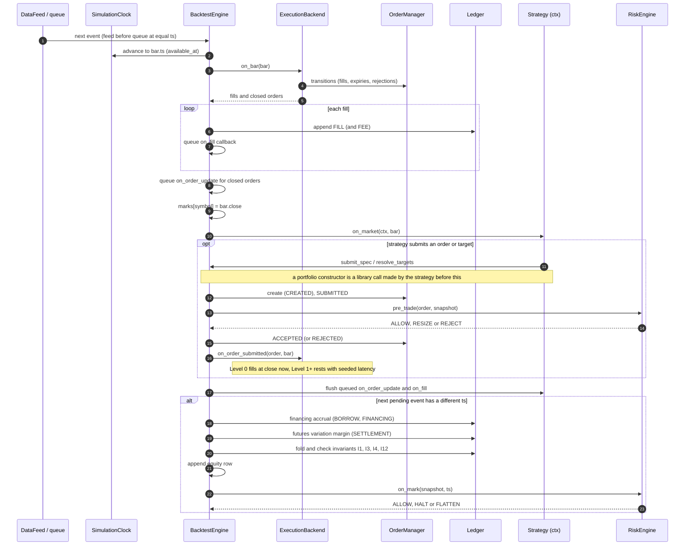
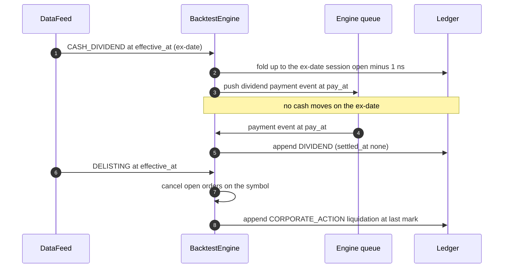

# TIMING — the per-event call order

> The exact order in which the run loop touches each component, and when
> settlement, financing, dividends and marks post. Source of truth is
> `crucible/core/engine.py` (`_process`, `_handle_bar`, `_handle_corporate_action`,
> `_go_live`, `_book_fill`, `_mark`); ordering decisions are in ADR-0010, -0012,
> -0026, -0028, -0032, -0033, -0034, -0039, -0046. If this file and the code
> disagree, one of them is a bug: fix the wrong one and say so in the commit.
> Units and sign conventions live in `docs/CONVENTIONS.md`; the meaning of the
> columns these steps write lives in `docs/SCHEMAS.md`.

## 1. The clock and the two queues

- **One clock, one sequence counter per run.** `SimulationClock.advance(ts)` only
  moves forward (I9). Nothing reads wall-clock time (AGENTS.md §9).
- **Two event sources.** The `DataFeed` (bars and dataset corporate actions,
  ADR-0039) and the engine's own `DeterministicEventQueue` (events the engine
  schedules mid-run: today only dividend pay-date events). `_next_event` pops the
  feed first when timestamps are equal, so engine-scheduled events always sort
  after feed events at a shared `ts`.
- **Event timestamp = when it became knowable.** A `BarEvent` carries
  `ts = available_at` (bar close + feed latency, ADR-0007), not the bar's
  `event_time`; `open_time` (session open, or the previous close as a pessimistic
  fallback) is carried separately and used only by the execution arrival rules.
  A `CorporateActionEvent` carries `ts = effective_at`.
- **Ordering within a timestamp** (feed): every bar before every corporate action
  (lower `seq`, ADR-0034); bars in `symbol` order; corporate actions in
  `(effective_at, symbol)` order. Then engine-queue events (dividend payments).
- **Marks are per timestamp, not per event.** After each event the engine asks
  whether the *next* pending event has the same `ts`; only when it does not is the
  book marked. Ten symbols reporting at one `available_at` produce one equity
  row, after all ten bars were handled.

## 2. Per-event call order

### 2.1 Run start

1. `feed.events()` stamps every event (eager feeds) — ids and `seq` are consumed
   here, before `on_start`, so event ids are identical across resume (ADR-0039).
2. `strategy.on_start(ctx)`, then the callback queue is flushed.
3. No mark is taken at start. The first equity row is the first timestamp's mark.

### 2.2 `BarEvent` (at `ts = available_at`)

| # | Step | Where | Writes |
|---|------|-------|--------|
| 1 | `clock.advance(bar.ts)` | `_process` | clock |
| 2 | **Execution** `backend.on_bar(bar)`: for every resting order of this symbol — no-time-travel check, latency check, arrival (full bar or mid bar), trigger evaluation, OCO adverse resolution, participation caps — returns `(fills, closed)`; then `MarketStats.update` (fills only ever see history up to the previous bar) | `ladder.py::on_bar` | order manager state |
| 3 | **Ledger** for each fill: `FILL` transaction (`ts = bar.ts`, price = the fill price, `settled_at = ts + lag` for positive equity proceeds only), then `FEE` transaction if commission > 0; a fill row; an `on_fill` callback is *queued* | `_book_fill` | ledger, `fill_rows` |
| 4 | Closed orders (`EXPIRED`, `REJECTED`, dead-parent children): log, queue `on_order_update`, cancel dormant children | `_handle_closures` | log |
| 5 | **Marks (price map)** `marks[symbol] = close` and `current_bar = bar` | `_handle_bar` | marks |
| 6 | **Strategy** `strategy.on_market(ctx, bar)` — data reads are PIT-guarded (`as_of <= clock.now`); orders and targets are submitted here (see 2.4) | strategy | orders |
| 7 | **Flush callbacks**: queued `on_order_update` / `on_fill` handlers run in the order queued, until the queue is empty (a callback may submit more orders, which queue more callbacks) | `_flush_callbacks` | — |
| 8 | If the next pending event has a different `ts` (or none): **mark** (2.5) | `_mark` | equity row |
| 9 | Debug observer hook fires | `_process` | — |

Consequences a strategy can rely on (also in `docs/modules/strategy.md`):

- A fill produced by bar *t* is booked **before** `on_market(bar t)` runs, so
  `ctx.portfolio` inside `on_market` already includes it; the `on_fill` callback
  for it arrives **after** `on_market` returns, at the same simulation time.
- An order submitted in `on_market(bar t)` has `created_at = t`. At Level >= 1 it
  can first interact with a bar whose `available_at > t` (no time travel) — a
  market order fills at the **next** bar's open (plus adverse slippage), booked at
  that bar's `available_at`. At Level 0 only, `on_order_submitted` fills a market
  order instantly at bar *t*'s close, inside step 6.
- A `MARKET_ON_CLOSE` order (ADR-0074) rests until the bar that ends at its `close_at` and fills
  at that bar's close in step 2 of that bar, so `on_market` of the closing bar already sees the
  position closed. It must arrive ten minutes before `close_at` (`MOC_CUTOFF_NS`).
- A fill's ledger `ts` is the fill bar's `available_at`, even though its price is
  usually that bar's open. Use `available_at` for "when did I learn about it".

### 2.3 `CorporateActionEvent` (at `ts = effective_at`)

Only `DELISTING` and `CASH_DIVIDEND` are implemented; any other type raises
`CrucibleError` (splits, spinoffs, mergers: see `docs/modules/accounting.md`).

- **`DELISTING`**: every open order on the symbol is cancelled (`CANCELLED`,
  `on_order_update` queued); a held position is closed with a `CORPORATE_ACTION`
  transaction at the **last mark** (no lookahead price exists). No mark price yet
  is an error.
- **`CASH_DIVIDEND`, ex-date event** (dataset row, `ts = effective_at`): the
  entitled quantity is the position held *strictly before the ex-date session
  opens* (ADR-0046: a fill at the ex-date open does not earn or owe). Received on
  longs, paid on shorts (`qty * per_share` carries the sign). No cash moves yet:
  a new event is pushed on the **engine queue** for `ts = pay_at`.
- **`CASH_DIVIDEND`, pay-date event** (engine queue, `ts = pay_at`): a `DIVIDEND`
  transaction posts, `settled_at = None` (immediate). Settlement lag does **not**
  stack on top of `pay_at` (ADR-0028).

### 2.4 Order submission path (from `on_market`, a callback, or a risk FLATTEN)

`ctx.orders.submit(...)` and `ctx.targets.set(...)` both reach the same pipeline.

1. **Portfolio constructor** (only when the strategy calls one): a *library call*
   made by the strategy inside its handler — `constructor.construct(signals,
   portfolio, as_of)` returns target weights. The engine never invokes a
   constructor itself.
2. **Target resolution** (only for `ctx.targets`): `resolve_target(s)` folds the
   ledger at `clock.now`, values equity in base currency at FX mid, computes
   `target_qty = trunc(weight * equity / mark)`, and submits a `MARKET` order for
   the delta. Symbols with no mark yet are skipped (logged).
3. `OrderManager.create` -> state `CREATED` (`created_at = clock.now`).
4. `_go_live`: `CREATED -> SUBMITTED`; if trading is halted -> `REJECTED`.
5. **Risk** `risk_engine.pre_trade(order, snapshot)`: `REJECT` -> `REJECTED` (final);
   `RESIZE` -> quantity reduced, continue; `ALLOW` -> continue. Non-ALLOW decisions
   are logged, never silent.
6. `SUBMITTED -> ACCEPTED`; `on_order_update(ACCEPTED)` is queued.
7. **Execution** `backend.on_order_submitted(order, current_bar)`: Level 0 returns
   the instant fill (booked at once through `_book_fill`); Level >= 1 draws the
   seeded latency once and rests the order (`effective_at = created_at + latency`).
   Composite orders (bracket/OCO/OTO) create dormant children that activate when
   the parent fills.

A risk-generated FLATTEN skips step 5 (`bypass_risk`) — a remedial action is not
re-checked by the limit that ordered it.

### 2.5 Mark (after the last event of a timestamp)

Order is fixed; each step reads the ledger as the previous step left it.

1. **Financing accrual** (`_accrue_financing`, ADR-0032), for the simulation time
   elapsed since the previous mark, Actual/365:
   short-borrow fee on each non-futures short (`BORROW` txn, on mark-to-market
   notional), then interest on each negative cash balance (`FINANCING` txn,
   computed on a fresh fold so the borrow fee just posted counts). Both are 0 at
   the default rates.
2. **Futures variation margin** (`_settle_futures_mtm`, ADR-0033): each open
   futures position settles its P&L since the last mark to cash as a
   close-and-reopen `SETTLEMENT` pair at the current mark. Equity positions keep
   unrealized P&L inside the position.
3. **Snapshot** `PortfolioSnapshot` from a fresh ledger fold at `clock.now`, FX
   mid rates as of `clock.now`.
4. **Invariants** `check_mark` re-derives cash, quantity and equity from the raw
   ledger and raises `InvariantViolation` on any mismatch (I1, I3, I4, I12).
5. **Equity row** appended: `ts, equity, cash, realized_pnl, fees_paid`.
6. **Risk** `risk_engine.on_mark(snapshot, ts)`: `HALT` sets the halted reason (all
   later orders are rejected); `FLATTEN` submits closing `MARKET` orders for every
   position (they fill on a later bar at Level >= 1). Refused with
   `ConfigurationError` under a venue backend that cannot fill mid-mark orders.

### 2.6 Run end

`strategy.on_end(ctx)`, callbacks flushed, results assembled. **No final mark** is
taken at end: the last equity row is the last event timestamp's mark.

## 3. When each money movement posts

| Movement | Posts at | Ledger type | Cash-available effect | Equity effect |
|----------|----------|-------------|-----------------------|---------------|
| Equity buy fill | fill bar's `available_at` | `FILL` (negative) | immediate | none at fill (cash -> position) |
| Equity sell fill | fill bar's `available_at` | `FILL` (positive) | joins *available* cash at `ts + settlement_lag_days` (ADR-0028) | immediate |
| Commission | with its fill | `FEE` (negative) | immediate | immediate |
| Futures fill | fill bar's `available_at` | `FILL`: only the realized share of variation margin; opening moves no cash | immediate (no lag) | immediate |
| Futures variation margin | every mark | `SETTLEMENT` pair | immediate | none extra (already in equity) |
| Cash dividend | `pay_at` (entitlement fixed at ex-date open) | `DIVIDEND` | immediate | at `pay_at` |
| Delisting liquidation | delisting `effective_at`, at last mark | `CORPORATE_ACTION` | per settlement lag if positive | immediate |
| Short borrow / margin financing | every mark, on elapsed time | `BORROW` / `FINANCING` (negative) | immediate | immediate |

Settlement lag is a *liquidity* concept: it delays buying power, never equity
(`AvailableCash <= Cash`, invariant I12).

## 4. Sequence diagram (one bar, event-driven, Level >= 1)

### Corporate actions and dividends

## 5. Vectorized path

The vectorized engine has no event loop: signals are shifted by the mandatory lag
(`docs/modules/vectorized.md`, ADR-0035), returns are computed once per period and
frictions are Level 0/1 only. Its timing contract is the shift, not this call
order; the agreement test pins the two engines together at Level 1.

## 6. Paper and live runtimes

The same loop, different seams (ADR-0043/0044). Paper replays a `DataFeed`; live
runs against a `SimulatedVenue`: per bar the venue feed first steps the venue, then
yields the venue's fill and closed-order events, then the bar, stamped at pull
time; the engine books them through the same `_book_fill`/`_handle_closures`. Known
divergences from the backtest order (a risk FLATTEN is refused, event-id numbering
differs) are in `docs/modules/live.md` and invariant I14.

## 7. Known gaps

- `Strategy.on_data` and `Strategy.on_session` exist on the Protocol (and
  `MultiStrategy` forwards them) but **the engine never calls them**: only
  `on_start`, `on_market`, `on_order_update`, `on_fill`, `on_end` are dispatched.
- `on_end` runs after the last mark: anything it submits is never marked or filled.
- IOC/FOK/GTD time-in-force are refused (need intrabar semantics); `DAY` expiry on
  bars is pinned in ADR-0010/0012.
